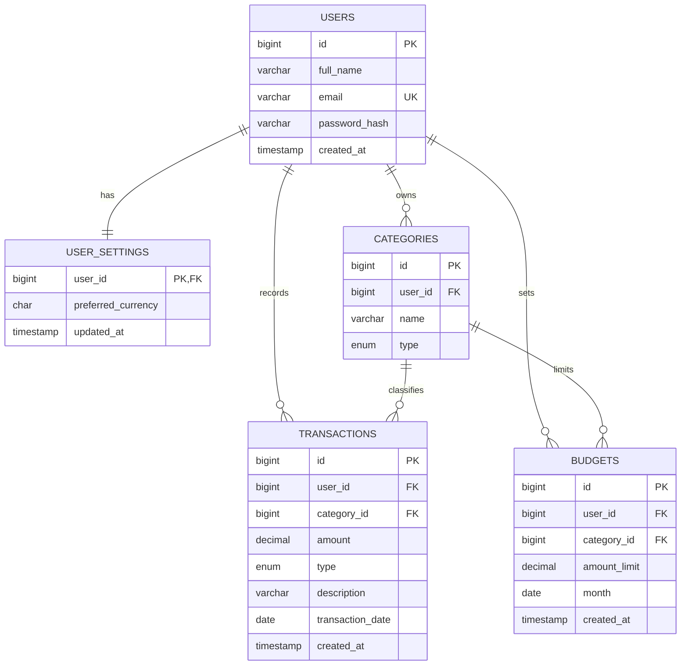

# SpendWise database relationships

This schema keeps the four core entities shown in the original `database-diagram.png` and adds `user_settings` for the preferred currency already shown on the profile screen.

Transactions and budgets include both `user_id` and `category_id`; composite foreign keys require that each selected category belongs to the same user as the row. Categories are unique by `(user_id, name, type)`, and each user can have only one budget per category and month.
